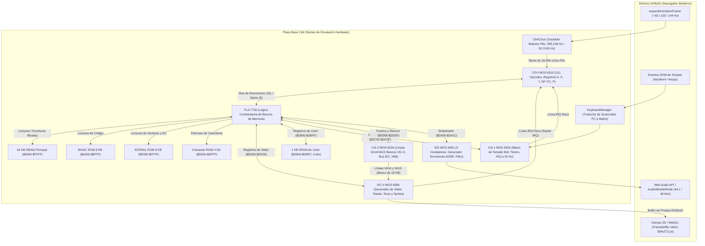
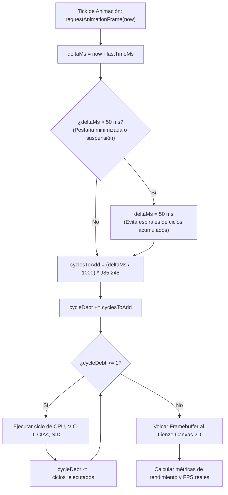
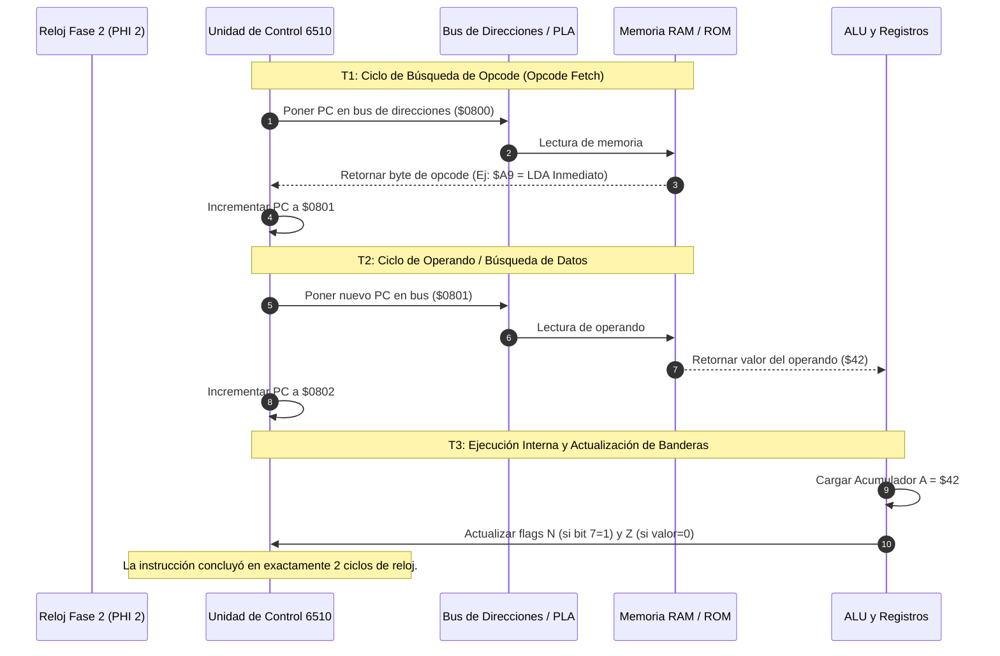
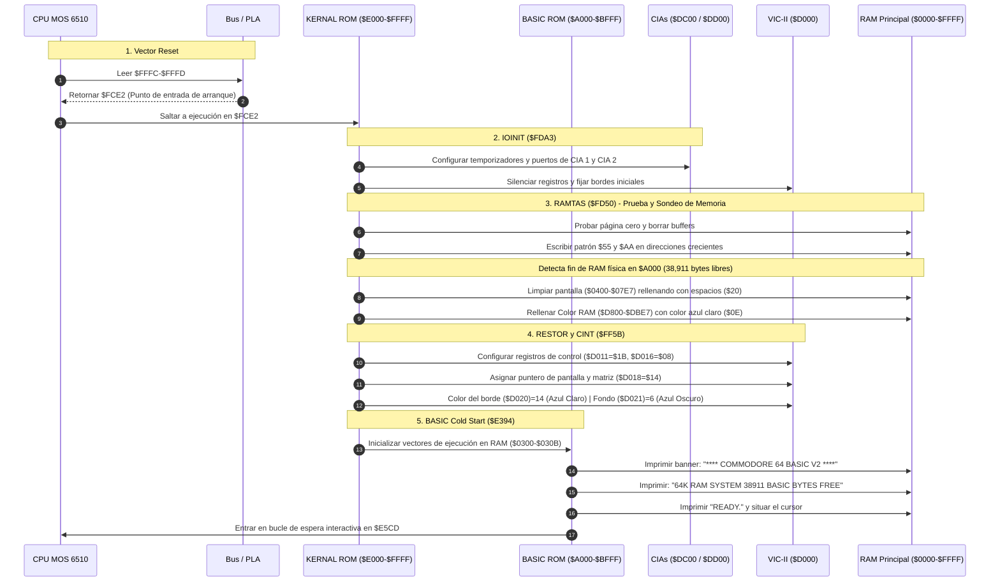
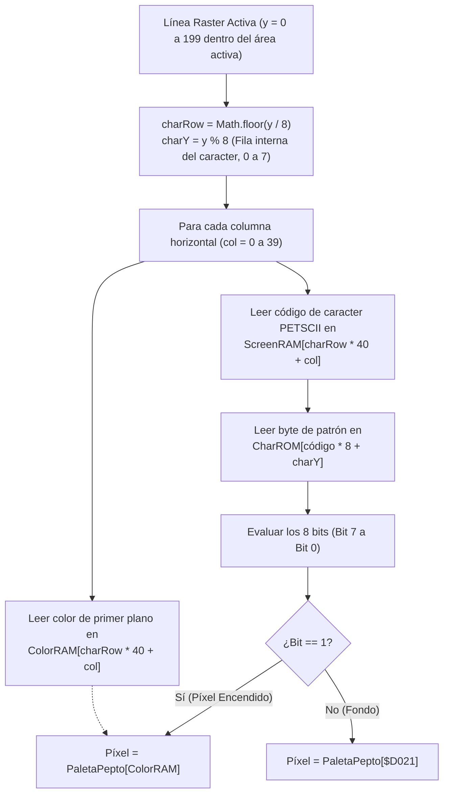

# DIARIO DE DESARROLLO - EMULADOR COMMODORE 64 WEB

Este documento es la bitácora técnica oficial, el cuaderno de laboratorio de ingeniería y el registro exhaustivo de arquitectura del emulador Commodore 64 para la web. Describe con máxima fidelidad cada decisión de diseño, modelado de ciclos de reloj, esquemas de circuitos integrados, mapas de memoria, máquinas de estado finitas y el funcionamiento a nivel de silicio de cada microchip emulado.

---

## 🗺️ Mapa de la Placa Base y Arquitectura General del Sistema

El Commodore 64 no es un ordenador estructurado con una arquitectura monolítica; es una obra maestra de ingeniería de bajo coste de 1982 construida alrededor de un conjunto de chips especializados (custom silicon) desarrollados por **MOS Technology** que comparten el bus principal mediante sincronización precisa en contrafase.

### Distribución Física de Circuitos Integrados en Placa (ASSY 250407 / 250425)

```text
+-----------------------------------------------------------------------------------+
|                           PUERTO DE EXPANSIÓN (CARTUCHO)                          |
|                                                                                   |
|  [U1: MOS 6526]      [U2: MOS 6526]       [U7: MOS 6510]      [U19: MOS 6569]     |
|       CIA 1               CIA 2                CPU                 VIC-II         |
|   (Teclado/Joy)       (IEC/Bancos VIC)     (Microprocesador)   (Video y Gráficos) |
|      (DIP-40)            (DIP-40)             (DIP-40)            (DIP-40 + Lona) |
|                                                                                   |
|  [U3: 2364 ROM]      [U4: 2364 ROM]       [U5: 2332 ROM]      [U18: MOS 6581]     |
|     BASIC ROM           KERNAL ROM           CHARGEN ROM            SID           |
|       (8 KB)              (8 KB)               (4 KB)            (Sonido/Filtro)  |
|                                                                                   |
|                      [U17: PLA 7700 / 82S100]                                     |
|                       Decodificador de Memoria                                    |
|                                                                                   |
|  [U9-U12: 4164]      [U21-U24: 4164]                          [U6: 2114 SRAM]     |
|   4x 64Kx1 DRAM       4x 64Kx1 DRAM                            1Kx4 Color RAM     |
|   (Banco Bajo RAM)    (Banco Alto RAM)                         (Memoria Color)    |
|                                                                                   |
|       PUERTOS DE JOYSTICK 1 Y 2             INTERRUPTOR Y ALIMENTACIÓN (9V AC/5V) |
+-----------------------------------------------------------------------------------+
```

### Arquitectura de Buses y Enlace de Subsistemas



---

## 📅 Módulo 1: Cimientos del Sistema (Duración de desarrollo: 17 días)

### 1. Filosofía de Silicio vs Simulación de Alto Nivel
El pilar central de este proyecto es la **fidelidad de hardware**:
- **Simulador:** Traduce comandos sintácticos en JavaScript (por ejemplo, simula un `PRINT` de BASIC imprimiendo cadenas en consola). No puede ejecutar juegos comerciales, demos con trucos de raster ni cargadores rápidos.
- **Emulador Real:** Modela las compuertas lógicas, las señales de reloj de dos fases, las tablas de verdad de conmutación de bus y la latencia física de cada instrucción. Las ROMs oficiales (`basic.bin`, `kernal.bin`, `chargen.bin`) se ejecutan de manera autónoma sin conocimiento de que corren sobre silicio emulado en un navegador web.

---

### 2. El Reloj Maestro y el Interleaving de Buses ($\Phi_1$ y $\Phi_2$)
En el hardware original del C64, el chip VIC-II y la CPU MOS 6510 comparten exactamente el mismo bus de memoria RAM sin necesidad de chips de arbitraje costosos. Esto fue posible gracias a un diseño ingenioso de **reloj de dos fases**:

```text
               Ciclo de Reloj Maestro (1.015 µs PAL)
      +-----------------------------+-----------------------------+
      |      Fase 1 (PHI 1, Bajo)   |     Fase 2 (PHI 2, Alto)    |
      +-----------------------------+-----------------------------+
BUS:  |   VIC-II Accede a la RAM    |    CPU Accede a la RAM      |
      |   (Lee Caracteres y Sprites)|    (Lectura/Escritura Opcodes)  |
      +-----------------------------+-----------------------------+
```

1. **Durante $\Phi_1$:** El VIC-II toma el bus de direcciones para buscar los datos del cuadro de video (punteros de pantalla, patrones de caracteres y gráficos). La CPU desconecta sus buffers del bus.
2. **Durante $\Phi_2$:** La CPU toma el bus para ejecutar sus ciclos de búsqueda de opcodes (`Fetch`) y acceso a memoria (`Execute`).

Gracias a este esquema de intercalado (*interleaving*), la CPU y el VIC-II operan a máxima velocidad de forma simultánea durante la mayor parte del tiempo, logrando una tasa de transferencia de datos de 2 MB/s con memorias DRAM económicas de 1982.

#### Cálculos de Temporización PAL
- **Frecuencia del Oscilador Principal PAL:** $f_{\text{master}} = 17,734,475\text{ Hz}$ (Cristal de cuarzo PAL).
- **Divisor del Reloj del Sistema:** La circuitería divide el cristal entre 18:
  $$f_{\text{cpu}} = \frac{17,734,475}{18} = 985,248.6\text{ Hz} \quad (\approx 0.98525\text{ MHz})$$
- **Geometría de Barrido del Haz de Electrones:**
  - Líneas totales por fotograma: $L = 312\text{ líneas}$.
  - Ciclos de reloj de CPU por línea raster: $C_{\text{line}} = 63\text{ ciclos}$.
  - Ciclos totales por fotograma: $C_{\text{frame}} = 312 \times 63 = 19,656\text{ ciclos}$.
  - Frecuencia vertical exacta (cuadros por segundo):
    $$f_v = \frac{985,248.6}{19,656} \approx 50.1245\text{ Hz}$$
  - Tiempo por fotograma: $T_f \approx 19.9503\text{ ms}$.

#### El Acumulador de Deuda Delta (`src/system/clock.ts`)
Dado que los monitores de PC modernos suelen refrescar a 60, 120 o 144 Hz, `requestAnimationFrame` no entrega intervalos de 50.1245 Hz de manera nativa. El emulador emplea un acumulador de tiempo con protección contra derivas:



---

### 3. El Decodificador de Memoria PLA (MOS 7700 / Signetics 82S100)

#### La Paradoja de los 64 KB y la Transparencia de Escritura
La CPU 6510 tiene un bus de direcciones de 16 bits, lo que le permite ver hasta 65,536 bytes a la vez ($0000-$FFFF). No obstante, el sistema incluye:
- **64 KB de RAM física.**
- **8 KB de BASIC ROM** en `$A000-$BFFF`.
- **8 KB de KERNAL ROM** en `$E000-$FFFF`.
- **4 KB de Character ROM** en `$D000-$DFFF`.
- **1 KB de Color RAM (SRAM estática)** en `$D800-$DBFF`.
- **4 KB de espacio de registros E/S** para chips VIC-II, SID y CIAs en `$D000-$DFFF`.

En total existen más de **85 KB** de elementos direccionables. El chip PLA (Programmable Logic Array) se encarga de conmutar dinámicamente qué dispositivo responde a cada lectura según las líneas de control del procesador:

```text
Espacio de Direcciones de la CPU ($0000 - $FFFF):
+-------------------------------------------------------------+ $FFFF
| KERNAL ROM (8 KB)  o  RAM Física Subyacente                |
+-------------------------------------------------------------+ $E000
| E/S (VIC, SID, CIA, Color RAM) o CHARGEN ROM o RAM         |
+-------------------------------------------------------------+ $D000
| RAM Física Normal (4 KB)                                    |
+-------------------------------------------------------------+ $C000
| BASIC ROM (8 KB)  o  RAM Física Subyacente                 |
+-------------------------------------------------------------+ $A000
| RAM Física de Usuario y Datos (32 KB continuos)             |
+-------------------------------------------------------------+ $2000
| Pila del Sistema (Stack: $0100-$01FF)                       |
+-------------------------------------------------------------+ $0100
| Página Cero (Zero Page: $0000-$00FF)                        |
| [$0000: DDR Puerto 6510]  [$0001: Bits LORAM, HIRAM, CHAREN]|
+-------------------------------------------------------------+ $0000
```

> [!IMPORTANT]
> **Regla de Oro de la Escritura en el C64:**  
> Las ROMs de silicio son físicamente incapaces de recibir escrituras. Por ello, en el C64, **cualquier intento de escritura en un rango ocupado por una ROM se desvía directamente a la RAM que descansa debajo**. Esto permite a los cargadores y descompresores escribir rutinas o datos en la RAM oculta bajo el KERNAL o BASIC, y luego deshabilitar las ROMs cambiando el puerto `$0001` a `$35` para ejecutar directamente sobre los 64 KB de RAM continua.

#### Tabla de Verdad de la PLA (Implementada en `src/memory/memory_bus.ts`):
| LORAM (Bit 0) | HIRAM (Bit 1) | CHAREN (Bit 2) | $A000-$BFFF (Lectura) | $D000-$DFFF (Lectura) | $E000-$FFFF (Lectura) | $D000-$DFFF (Escritura) |
|:---:|:---:|:---:|:---:|:---:|:---:|:---:|
| 0 | 0 | x | RAM | RAM | RAM | RAM |
| 1 | 0 | 0 | RAM | CHARGEN ROM | RAM | RAM |
| 1 | 0 | 1 | RAM | Registros E/S | RAM | Registros E/S |
| 0 | 1 | 0 | RAM | CHARGEN ROM | KERNAL ROM | RAM |
| 0 | 1 | 1 | RAM | Registros E/S | KERNAL ROM | Registros E/S |
| 1 | 1 | 0 | BASIC ROM | CHARGEN ROM | KERNAL ROM | RAM |
| **1** | **1** | **1** | **BASIC ROM** | **Registros E/S** | **KERNAL ROM** | **Registros E/S** *(Estado por defecto al arrancar)* |

---

## 📅 Módulo 2: CPU MOS 6510 (Duración de desarrollo: 4 días)

### 1. El Microprocesador MOS 6510 y su Encapsulado Físico
El MOS 6510 comparte la microarquitectura de ejecución del afamado MOS 6502, pero integra en su propio sustrato de silicio un puerto bidireccional de E/S de 6 bits mapeado en las direcciones de memoria `$0000` y `$0001`.

#### Pinout del Circuito Integrado DIP-40 (MOS 6510):
```text
                          +-------V-------+
                 VSS (GND)| 1           40| RES (Reset, activo bajo)
                      RDY | 2           39| PHI 2 (Salida Reloj Fase 2)
                    PHI 0 | 3           38| SO (Set Overflow)
        IRQ (Activo bajo) | 4           37| PHI 2 (Entrada Reloj)
                      AEC | 5           36| VDD (+5V DC)
        NMI (Activo bajo) | 6           35| P5 (Puerto I/O Bit 5: Motor Cassette)
                 SYNC/VCC | 7           34| P4 (Puerto I/O Bit 4: Sensor Cassette)
                       A0 | 8           33| P3 (Puerto I/O Bit 3: Escritura Cassette)
                       A1 | 9           32| P2 (Puerto I/O Bit 2: CHAREN - PLA)
                       A2 | 10   MOS    31| P1 (Puerto I/O Bit 1: HIRAM - PLA)
                       A3 | 11   6510   30| P0 (Puerto I/O Bit 0: LORAM - PLA)
                       A4 | 12          29| P5 / NC
                       A5 | 13   CPU    28| R/W (Read / Write)
                       A6 | 14          27| D7 (Línea de Datos 7)
                       A7 | 15          26| D6 (Línea de Datos 6)
                       A8 | 16          25| D5 (Línea de Datos 5)
                       A9 | 17          24| D4 (Línea de Datos 4)
                      A10 | 18          23| D3 (Línea de Datos 3)
                      A11 | 19          22| D2 (Línea de Datos 2)
                      A12 | 20          21| D1 (Línea de Datos 1)
                          +---------------+
```

---

### 2. Estructura Interna de Registros y ALU
La CPU contiene un banco de registros de 8 y 16 bits conectado a una ALU elemental y una red de decodificación de instrucciones por micro-secuencia:

```text
+---------------------------------------------------------------------------------+
|                              MOS 6510 CPU INTERNALS                             |
|                                                                                 |
|  +-------------------+  +-------------------+  +-----------------------------+  |
|  |  Acumulador A (8) |  |   Índice X (8)    |  |   Contador de Prog. PC (16) |  |
|  +-------------------+  +-------------------+  +-----------------------------+  |
|  |  Puntero Pila SP  |  |   Índice Y (8)    |  |   Registro de Estado P (8)  |  |
|  +-------------------+  +-------------------+  +-----------------------------+  |
|           |                       |                           |                 |
|           +-----------+-----------+                           |                 |
|                       |                                       |                 |
|                       v                                       v                 |
|           +-----------------------+              +---------------------------+  |
|           | ALU (Aritmética/Lógica) | <--------> | Banderas de Estado (NV-BDIZC) |
|           | Operaciones: +, -, &, |              +---------------------------+  |
|           | XOR, Shifts, ROR, ROL |                                             |
|           +-----------------------+                                             |
|                       |                                                         |
|                       v                                                         |
|           +-----------------------------------------------+                     |
|           | Puerto E/S Integrado ($0000=DDR, $0001=Datos) |                     |
|           | Control directo de LORAM, HIRAM y CHAREN      |                     |
|           +-----------------------------------------------+                     |
+---------------------------------------------------------------------------------+
```

#### Anatomía del Registro de Banderas de Estado (`P`):
```text
  Bit 7      Bit 6      Bit 5      Bit 4      Bit 3      Bit 2      Bit 1      Bit 0
+----------+----------+----------+----------+----------+----------+----------+----------+
|    N     |    V     |    -     |    B     |    D     |    I     |    Z     |    C     |
| Negative | Overflow | Reservado|  Break   | Decimal  | Interr.  |   Zero   |  Carry   |
+----------+----------+----------+----------+----------+----------+----------+----------+
```
- **N (Negative):** Refleja directamente el bit 7 del resultado ($1 = \text{Negativo}$).
- **V (Overflow):** Señal de desbordamiento en complemento a dos con signo:
  $$V = (\sim(A \oplus M) \land (A \oplus \text{Resultado}) \land 0x80) \neq 0$$
- **B (Break):** Diferencia si la interrupción fue gatillada por instrucción `BRK` ($B=1$) o por una señal eléctrica externa en el pin IRQ ($B=0$).
- **D (Decimal):** Activa el modo BCD (aritmética decimal empaquetada).
- **I (Interrupt Disable):** Máscara de interrupción. Cuando vale 1, la CPU ignora la línea física de interrupción `IRQ`.
- **Z (Zero):** Se activa cuando el resultado de una operación es exactamente cero.
- **C (Carry):** Acarreo en sumas, préstamo invertido en restas y bit expulsado en rotaciones.

---

### 3. Ciclo de Ejecución de Instrucciones (Fetch - Decode - Execute)



#### El Fallo Histórico de Hardware en `JMP ($xxFF)`
En el microprocesador 6502 original existe un célebre defecto en el cálculo del puntero indirecto cuando el operando cruza el final de una página de 256 bytes (`$xxFF`):

```text
Código ASM: JMP ($02FF)

Comportamiento Teórico Ideal:
Byte Bajo del Salto  <-- Memoria en $02FF
Byte Alto del Salto  <-- Memoria en $0300 ($02FF + 1)

Comportamiento Físico en Silicio NMOS (Replicado en src/cpu/cpu6510.ts):
Byte Bajo del Salto  <-- Memoria en $02FF
Byte Alto del Salto  <-- Memoria en $0200  <-- ¡Envolvente de 8 bits sin propagar acarreo!
```
El silicio original incrementa únicamente el contador interno de 8 bits del byte bajo sin propagar el acarreo hacia el byte alto. Si un emulador no emula este comportamiento erróneo, programas clásicos y suites de verificación fallan de inmediato.

---

### 4. Aritmética BCD en el NMOS 6502
A diferencia de procesadores CMOS posteriores (como el 65C02), el chip NMOS original calcula las banderas `N` y `Z` antes de aplicar las correcciones decimales, y realiza ajustes separados de nibble bajo ($+6$) y nibble alto ($+6$) según la presencia de acarreos binarios intermedios.

---

### 5. Validación con el Banco de Pruebas de Klaus Dormann
La CPU fue validada contra la suite funcional de Klaus Dormann (`tests/6502_functional_test.bin`), el estándar definitivo de la industria de emulación:

```text
> npm run test:cpu

🏁 Iniciando suite de pruebas funcionales de Klaus Dormann (6502)...
   Punto de partida: PC=$0400 | Objetivo de éxito: PC=$3469

🎉 ¡ÉXITO TOTAL! Test de Klaus Dormann SUPERADO.
   Atrapado en el bucle de éxito: $3469
   Instrucciones ejecutadas: 30.646.177
   Ciclos de reloj de CPU: 96.241.381
   Tiempo transcurrido: 1.30s
```

La suite ejecutó más de **30 millones de instrucciones** y **96 millones de ciclos de reloj** cubriendo todas las permutaciones de modos de direccionamiento, banderas y desbordamientos aritméticos con un 100% de éxito.

---

## 📅 Módulo 3: Arranque a Pantalla de Texto y VIC-II Básico (Duración de desarrollo: 6 días)

### 1. El Generador de Video MOS 6569 (VIC-II)
El chip VIC-II es el responsable de toda la generación gráfica y de video, multiplexando el bus de memoria, generando sincronismo compuesto y componiendo capas de bordes, texto y sprites.

#### Pinout del Circuito Integrado DIP-40 (MOS 6569 PAL):
```text
                          +-------V-------+
                      DB6 | 1           40| DB7 (Línea de Datos 7)
                      DB5 | 2           39| DB8 (Línea de Datos 8)
                      DB4 | 3           38| DB9 (Línea de Datos 9)
                      DB3 | 4           37| DB10 (Línea de Datos 10)
                      DB2 | 5           36| DB11 (Línea de Datos 11)
                      DB1 | 6           35| IRQ (Salida Interrupción Raster)
                      DB0 | 7   MOS     34| LP (Entrada Lápiz Óptico)
                      IRQ | 8   6569    33| CS (Chip Select, activo bajo)
                      R/W | 9   VIC-II  32| RW (Lectura / Escritura)
                    COLOR | 10  (PAL)   31| SYNC (Sincronismo de Video)
                 LUMA/Y   | 11          30| BA (Bus Available - Ciclos robados)
                  CHROMA  | 12          29| AEC (Address Enable Control)
                     VCC  | 13          28| PHI 0 (Entrada de Reloj)
                      A0  | 14          27| PHI IN (Reloj Invertido)
                      A1  | 15          26| A13 (Línea de Dirección 13)
                      A2  | 16          25| A12 (Línea de Dirección 12)
                      A3  | 17          24| A11 (Línea de Dirección 11)
                      A4  | 18          23| A10 (Línea de Dirección 10)
                      A5  | 19          22| A9  (Línea de Dirección 9)
                     VSS  | 20          21| A8  (Línea de Dirección 8)
                          +---------------+
```

---

### 2. Secuencia de Arranque Autónomo del KERNAL (Primer Hito)

Cuando se enciende el Commodore 64, la CPU lee el vector de Reset ubicado en `$FFFC-$FFFD`, el cual apunta a la dirección `$FCE2` dentro de la ROM del KERNAL. A partir de allí, el sistema operativo toma el control:



---

### 3. Geometría y Temporización del Raster PAL
El cuadro de visualización PAL consta de 312 líneas horizontales de barrido:

```text
Línea 0   +-------------------------------------------------------------+
          |  BORDE SUPERIOR (36 líneas de altura)                      |
          |  Color configurado en registro $D020 (Azul Claro #14)       |
Línea 36  +--------+------------------------------------------+---------+
          | BORDE  | ÁREA ACTIVA DE TEXTO Y GRÁFICOS          | BORDE   |
          | IZQ.   | (320 x 200 píxeles = 40 cols x 25 filas) | DCHO.   |
          | 32 px  | Color de fondo en $D021 (Azul Oscuro #6) | 32 px   |
          |        | Colores de texto en Color RAM ($D800)    |         |
Línea 235 +--------+------------------------------------------+---------+
          |  BORDE INFERIOR (36 líneas de altura)                      |
          |  Color configurado en registro $D020 (Azul Claro #14)       |
Línea 271 +-------------------------------------------------------------+
Línea 311    (Líneas de sincronismo vertical y retorno VBLANK no visibles)
```

- **Ancho Total del Framebuffer:** 384 píxeles (32 px borde izq + 320 px área activa + 32 px borde dcho).
- **Alto Total del Framebuffer:** 272 píxeles (36 px borde sup + 200 px área activa + 36 px borde inf).

---

### 4. Pipeline de Decodificación del Registro `$D018`
El registro `$D018` gobierna de dónde toma el VIC-II los caracteres y la memoria de video dentro del banco de 16 KB seleccionado por las líneas VA14/VA15 de la CIA 2:

```text
Registro $D018 (Memory Setup Register):
+-------+-------+-------+-------+-------+-------+-------+-------+
|   Bit 7   |   Bit 6   |   Bit 5   |   Bit 4   |   Bit 3   |   Bit 2   |   Bit 1   |   Bit 0   |
+-------+-------+-------+-------+-------+-------+-------+-------+
\_______________________________/ \_______________________________/ \_______/
   Screen Matrix Pointer (VM13-VM10)  Character Dot Pointer (CB13-CB11)   No usado
       (Offset en bloques de 1 KB)        (Offset en bloques de 2 KB)
```
- **Al arrancar:** `$D018` tiene el valor `$14` (`%00010100`).
  - Bits 7-4 = `0001` $\rightarrow$ Screen RAM en offset `$0400` ($1 \times 1024$).
  - Bits 3-1 = `010` $\rightarrow$ Character ROM en offset `$1000` ($2 \times 2048$).

#### Pipeline de Renderizado Píxel a Píxel (`src/vic/vic2.ts`):


#### La Paleta Oficial Pepto del Commodore 64:
El C64 genera colores mediante un circuito analógico Y/C (Luminancia y Crominancia). La paleta Pepto es el estándar fidedigno de reproducción cromática:

| Código | Color Hexadecimal | Nombre Oficial | Uso Principal |
|:---:|:---:|:---|:---|
| 0 | `#000000` | Negro | Fondos y gráficos oscuros |
| 1 | `#FFFFFF` | Blanco | Texto alternativo |
| 2 | `#880000` | Rojo | Gráficos |
| 3 | `#AAFFEE` | Cian | Efectos de color |
| 4 | `#CC44CC` | Púrpura | Gráficos |
| 5 | `#00CC55` | Verde | Gráficos |
| 6 | `#0000AA` | **Azul Oscuro** | **Fondo clásico de la pantalla de inicio** |
| 7 | `#EEEE77` | Amarillo | Gráficos |
| 8 | `#DD8855` | Naranja | Gráficos |
| 9 | `#664400` | Marrón | Gráficos |
| 10 | `#FF7777` | Rojo Claro | Gráficos |
| 11 | `#333333` | Gris Oscuro 1 | Gráficos |
| 12 | `#777777` | Gris Medio 2 | Gráficos |
| 13 | `#AAFF66` | Verde Claro | Gráficos |
| 14 | `#0088FF` | **Azul Claro** | **Borde clásico de inicio y color de texto** |
| 15 | `#BBBBBB` | Gris Claro 3 | Gráficos |

---

## 📅 Módulo 4: Teclado y E/S (CIA 1) y BASIC V2 Interactivo (Duración de desarrollo: 19 días)

### 1. El Chip MOS 6526 (Complex Interface Adapter - CIA)
El Commodore 64 cuenta con dos chips CIA idénticos encargados del control de periféricos de entrada y salida:
- **CIA 1 ($DC00):** Dedicada a la matriz del teclado, puertos de joystick 1 y 2, y generación de interrupciones periódicas `IRQ`.
- **CIA 2 ($DD00):** Dedicada al control del bus serie IEC (unidad de disco 1541), líneas de control del puerto de usuario y las dos líneas de dirección `VA14` y `VA15` que conmutan los 4 bancos de 16 KB del VIC-II.

#### Pinout del Circuito Integrado DIP-40 (MOS 6526 CIA):
```text
                          +-------V-------+
                 VSS (GND)| 1           40| CNT (Contador / Reloj Externo)
                      PA0 | 2           39| SP (Puerto Serie Bidireccional)
                      PA1 | 3           38| RS0 (Registro Select 0)
                      PA2 | 4           37| RS1 (Registro Select 1)
                      PA3 | 5           36| RS2 (Registro Select 2)
                      PA4 | 6           35| RS3 (Registro Select 3)
                      PA5 | 7           34| RES (Reset, activo bajo)
                      PA6 | 8           33| DB0 (Bus de Datos 0)
                      PA7 | 9   MOS     32| DB1 (Bus de Datos 1)
                      PB0 | 10  6526    31| DB2 (Bus de Datos 2)
                      PB1 | 11  CIA     30| DB3 (Bus de Datos 3)
                      PB2 | 12          29| DB4 (Bus de Datos 4)
                      PB3 | 13          28| DB5 (Bus de Datos 5)
                      PB4 | 14          27| DB6 (Bus de Datos 6)
                      PB5 | 15          26| DB7 (Bus de Datos 7)
                      PB6 | 16          25| PHI 2 (Reloj del Sistema)
                      PB7 | 17          24| CS (Chip Select, activo bajo)
                       PC | 18          23| FLAG (Entrada de señal externa)
                      TOD | 19          22| R/W (Lectura / Escritura)
                      VDD | 20          21| IRQ (Salida de Interrupción)
                          +---------------+
```

#### Diagrama de Arquitectura Interna del MOS 6526:
```text
+---------------------------------------------------------------------------------+
|                                MOS 6526 CIA CORE                                |
|                                                                                 |
|  +---------------------------+       +---------------------------------------+  |
|  | Puerto A (PRA: 8 bits)    |       | Timer A (16 bits, cuenta regresiva)   |  |
|  | Dirección E/S (DDRA: 8 b) |       | Modos: Continuo o One-Shot            |  |
|  +---------------------------+       +---------------------------------------+  |
|  +---------------------------+       +---------------------------------------+  |
|  | Puerto B (PRB: 8 bits)    |       | Timer B (16 bits, cuenta regresiva)   |  |
|  | Dirección E/S (DDRB: 8 b) |       | Puede encadenarse a underflows de A   |  |
|  +---------------------------+       +---------------------------------------+  |
|                                                                                 |
|  +---------------------------+       +---------------------------------------+  |
|  | TOD (Time Of Day)         |       | SDR (Serial Data Register)            |  |
|  | Reloj RTC a 50/60 Hz      |       | Comunicación serie síncrona           |  |
|  +---------------------------+       +---------------------------------------+  |
|                                                                                 |
|  +---------------------------------------------------------------------------+  |
|  | ICR (Interrupt Control Register) & IMR (Interrupt Mask Register)          |  |
|  | Gestiona eventos de Timer A, Timer B, TOD, Serie y línea externa FLAG    |  |
|  +---------------------------------------------------------------------------+  |
+---------------------------------------------------------------------------------+
```

---

### 2. Circuito Eléctrico de la Matriz de Teclado (CIA 1 $DC00 / $DC01)
El teclado físico del Commodore 64 no cuenta con ningún microcontrolador integrado. Es una matriz pasiva de 64 pulsadores mecánicos conectados en una rejilla de 8 columnas por 8 filas:

```text
               Esquema Eléctrico de Escaneo de una Tecla (Ej: Tecla 'A')

  Puerto A ($DC00) Columna 1 (Bit 1)
  ---+--------------------------------------------
     |
     o  Pulsador Mecánico de Tecla 'A'
      \
     o
     |
  ---+--------------------------------------------
     |
     +---/\/\/\/\---+ (+5V Pull-up)
     |    Resistencia
     |
  Puerto B ($DC01) Fila 2 (Bit 2)
```

1. **Estado en Reposo:** Las 8 entradas del Puerto B se mantienen a nivel alto (+5V lógico = `1`) gracias a resistencias internas de pull-up.
2. **Escaneo de Columna:** La rutina del KERNAL escribe un patrón en el Puerto A con un bit en nivel bajo (`0`) en la columna deseada (por ejemplo, `$FD` = `%11111101` para seleccionar la columna 1).
3. **Cierre de Contacto:** Si la tecla `A` está presionada, el contacto metálico une la columna 1 con la fila 2, conduciendo el nivel de masa (`0`) hacia el bit 2 del Puerto B.
4. **Lectura:** La CPU lee el Puerto B y detecta que el bit 2 es `0`, concluyendo inequívocamente que la tecla `A` está pulsada.

#### La Matriz Completa de 8×8 Teclas:
| Fila \ Columna | Col 0 ($FE) | Col 1 ($FD) | Col 2 ($FB) | Col 3 ($F7) | Col 4 ($EF) | Col 5 ($DF) | Col 6 ($BF) | Col 7 ($7F) |
|:---:|:---:|:---:|:---:|:---:|:---:|:---:|:---:|
| **Row 0** | DEL | 3 | 5 | 7 | 9 | + | POUND (£) | 1 |
| **Row 1** | RETURN | W | R | Y | I | P | * | LEFT-ARROW (←) |
| **Row 2** | CRSR-RIGHT | A | D | G | J | L | ; | CTRL |
| **Row 3** | F7 | 4 | 6 | 8 | 0 | - | HOME/CLR | 2 |
| **Row 4** | F1 | Z | C | B | M | . | RIGHT-SHIFT | SPACE |
| **Row 5** | F3 | S | F | H | K | : | = | COMMODORE (C=) |
| **Row 6** | F5 | E | T | U | O | @ | UP-ARROW (↑) | Q |
| **Row 7** | CRSR-DOWN | LEFT-SHIFT | X | V | N | , | / | RUN/STOP |

---

### 3. El Bucle de Interrupciones de 50 Hz, el Cursor y el Búfer KERNAL

El cursor titilante y la respuesta interactiva del C64 no corren en un bucle ciego de espera; son controlados por la interrupción periódica que dispara el **Timer A de la CIA 1**:

```mermaid
sequenceDiagram
    autonumber
    participant Timer as CIA 1 Timer A
    participant CPU as CPU MOS 6510
    participant IRQ as Vector IRQ ($0314 -> $EA31)
    participant Blink as Rutina Parpadeo Cursor
    participant SCNKEY as Rutina SCNKEY ($FF9F)
    participant Buffer as Búfer Circular Teclado ($0277)
    participant BASIC as Bucle BASIC ($E5CD)
    participant Screen as Pantalla VIC-II

    Timer->>CPU: Señal eléctrica IRQ (Underflow a ~50 Hz)
    CPU->>IRQ: Salto a vector de interrupción de KERNAL ($EA31)
    IRQ->>Blink: Decrementar contador ($0292); al llegar a 0 invertir caracter del cursor
    Blink->>Screen: Mostrar/Ocultar bloque parpadeante
    IRQ->>SCNKEY: Excitar columnas en $DC00 y leer filas en $DC01
    SCNKEY->>SCNKEY: Comparar con tabla PETSCII en ROM ($EB81)
    SCNKEY->>Buffer: Si hay nueva tecla, almacenar código PETSCII en $0277
    IRQ->>Timer: Leer registro $DC0D (Acknowledge que limpia la señal IRQ)
    IRQ-->>CPU: Ejecutar RTI (Retorno de interrupción)
    
    BASIC->>Buffer: Llamar a GETIN ($FFE4) para leer caracter pendiente
    BASIC->>Screen: Llamar a CHROUT ($FFD2) para imprimir caracter y avanzar posición
```

#### Estructura del Búfer Circular de Teclado en Memoria KERNAL:
```text
Dirección $0289: Longitud máxima del búfer (Por defecto: 10 caracteres)
Dirección $0277 - $0280: Búfer FIFO de 10 bytes para códigos PETSCII
Dirección $00C6: Puntero de número de teclas esperando en el búfer (0 a 10)

+------+------+------+------+------+------+------+------+------+------+
| $0277| $0278| $0279| $027A| $027B| $027C| $027D| $027E| $027F| $0280|
| '1'  | '0'  | ' '  | 'P'  | 'R'  | 'I'  | 'N'  | 'T'  |  "   |  "   |
+------+------+------+------+------+------+------+------+------+------+
```

---

### 4. Gestor de Teclado Moderno (`KeyboardManager` en `src/io/keyboard.ts`)
Para que un usuario pueda escribir fluidamente desde un teclado moderno de PC (USB o portátil) hacia la matriz pasiva del C64, el emulador implementa un traductor con las siguientes funciones:

1. **Teclas Especiales del Sistema:**
   - `Enter` $\rightarrow$ `RETURN` (Columna 0, Fila 1).
   - `Backspace` $\rightarrow$ `DEL` (Columna 0, Fila 0).
   - `Escape` $\rightarrow$ `RUN/STOP` (Columna 7, Fila 7).
   - `LeftControl` / `Tab` $\rightarrow$ Tecla **`COMMODORE (C=)`** (Columna 7, Fila 5).
   - `PageUp` / `F12` $\rightarrow$ Tecla **`RESTORE`** (gatilla una interrupción no enmascarable `NMI` directa en la CPU).
   - `CapsLock` $\rightarrow$ **`SHIFT LOCK`** (mantiene enclavada la línea de `LEFT-SHIFT`).
2. **Composición Simbólica Automática:**
   - En un PC, las comillas dobles `"` se generan con `Shift + '` o tecla dedicada según la distribución del teclado.
   - En el C64, las comillas dobles `"` se ubican físicamente en **`Shift + 2`**.
   - El `KeyboardManager` detecta el caracter `"` e inyecta la combinación física exacta (`LEFT-SHIFT` en Col 1, Row 7 + `2` en Col 7, Row 3), garantizando que las líneas de código BASIC se escriban de forma natural y sin fricciones.

---

### 5. Validación del Segundo Hito: Ejecución de BASIC V2

Mediante la prueba automatizada `tests/test_keyboard_basic.ts` (`npm run test:keyboard`), se validó la inyección secuencial de caracteres, la lectura de la matriz por parte del KERNAL y la ejecución del programa por el intérprete de BASIC:

```text
> npm run test:keyboard

🚀 1. Booteando C64 hasta llegar a READY...
⌨️  2. Escribiendo programa: 10 PRINT "HOLA"...
▶️  3. Escribiendo comando: RUN...
⏳ 4. Ejecutando programa BASIC...

================ PANTALLA C64 TRAS EJECUTAR BASIC ================
Fila 01: [    **** COMMODORE 64 BASIC V2 ****     ]
Fila 03: [ 64K RAM SYSTEM  38911 BASIC BYTES FREE ]
Fila 05: [READY.                                  ]
Fila 06: [10 PRINT "HOLA"                         ]
Fila 07: [RUN                                     ]
Fila 08: [HOLA                                    ]
Fila 10: [READY.                                  ]
==================================================================

🎉 ¡SEGUNDO HITO SUPERADO CON ÉXITO!
   El programa BASIC V2 fue tecleado, interpretado y ejecutado.
   "HOLA" y "READY." se encuentran correctamente en pantalla.
```

---

## 📊 Matriz de Resumen y Estado Técnico de Hitos

| Módulo | Subsistema de Hardware | Duración | Estado | Validación Técnica |
| :--- | :--- | :---: | :---: | :--- |
| **Módulo 1** | Cimientos, PLA Banking, Temporización PAL | 17 días | ✅ Completado | Bus de memoria con transparencia de escritura, bucle de reloj a 50.12 Hz |
| **Módulo 2** | CPU MOS 6510 (151 Opcodes oficiales, BCD) | 4 días | ✅ Completado | Suite Klaus Dormann 100% superada (96,241,381 ciclos de reloj verificados) |
| **Módulo 3** | KERNAL/BASIC Boot, VIC-II Texto 40x25 | 6 días | ✅ Completado | **Primer Hito:** Pantalla de arranque clásica y prompt `READY.` |
| **Módulo 4** | Matriz Teclado CIA 1, Timers 50Hz, Web Keys | 19 días | ✅ Completado | **Segundo Hito:** Escritura y ejecución de programas en BASIC V2 interactivo |
