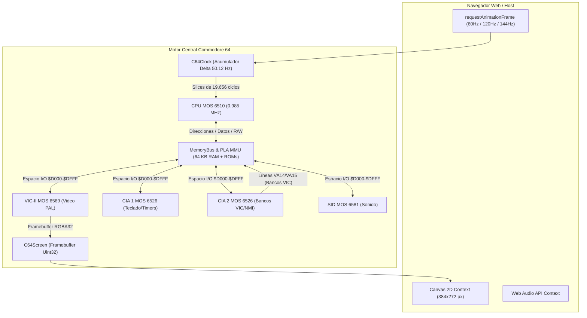
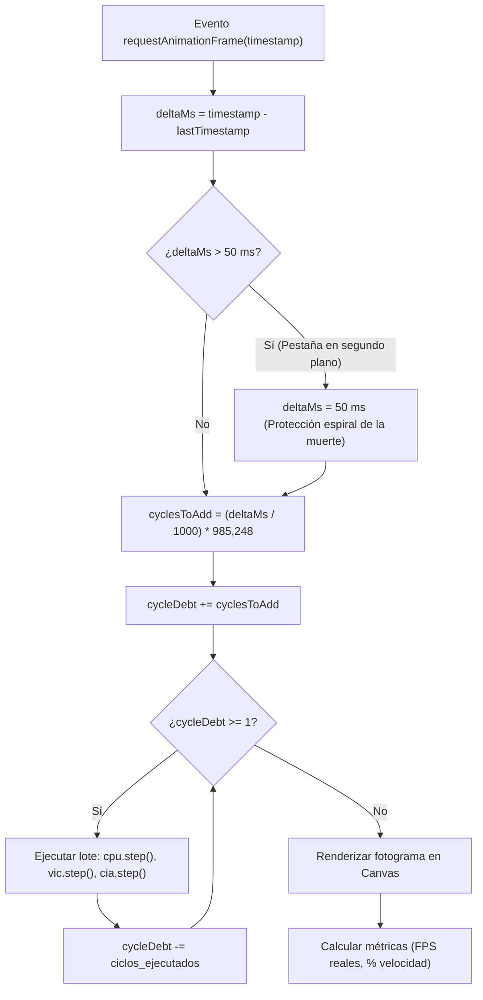
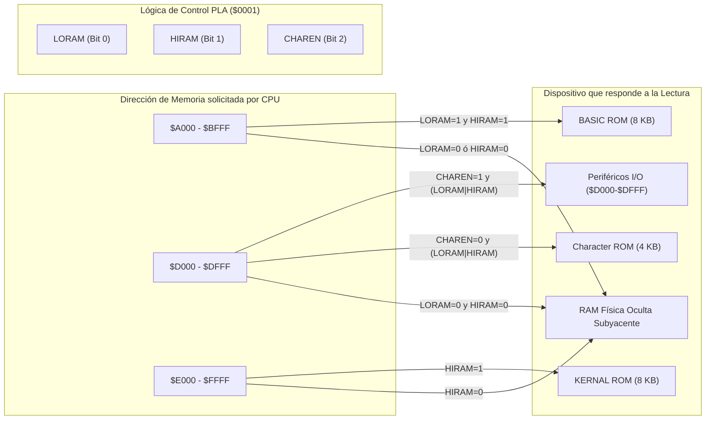
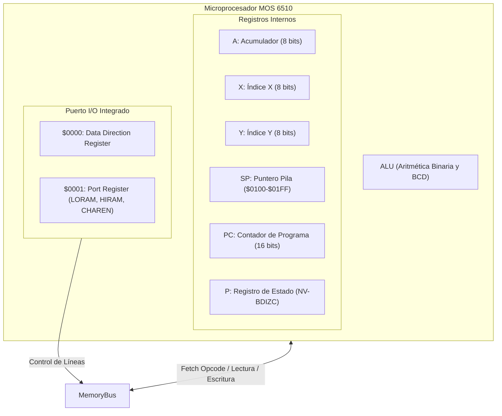
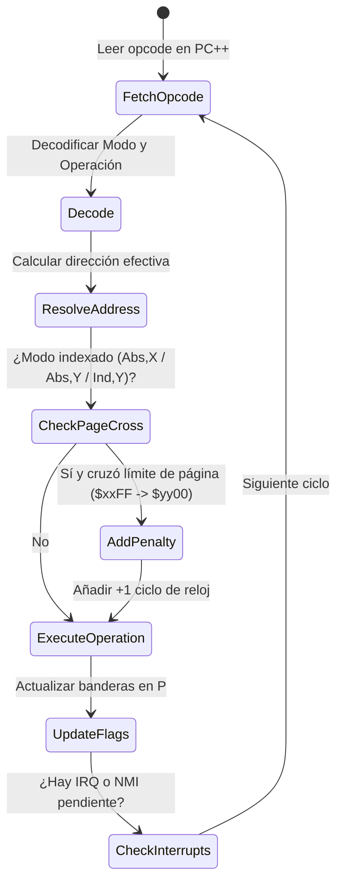
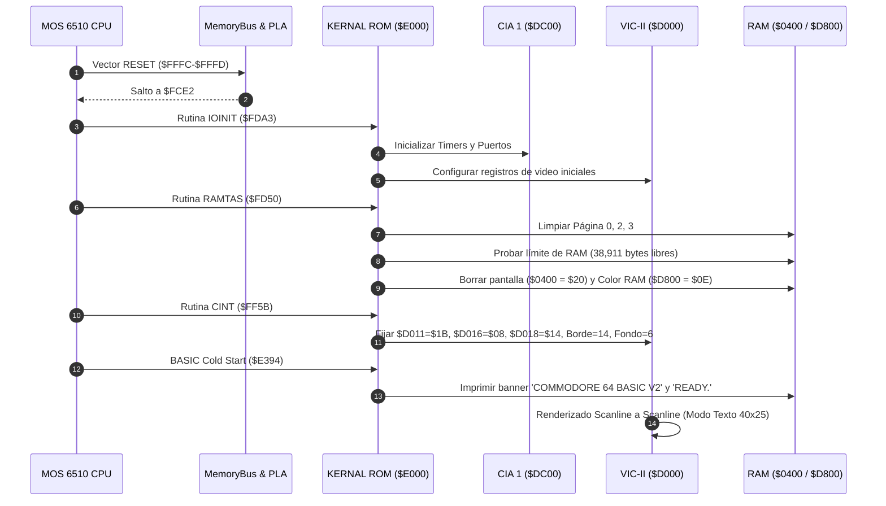
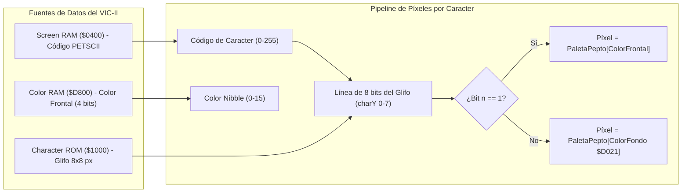
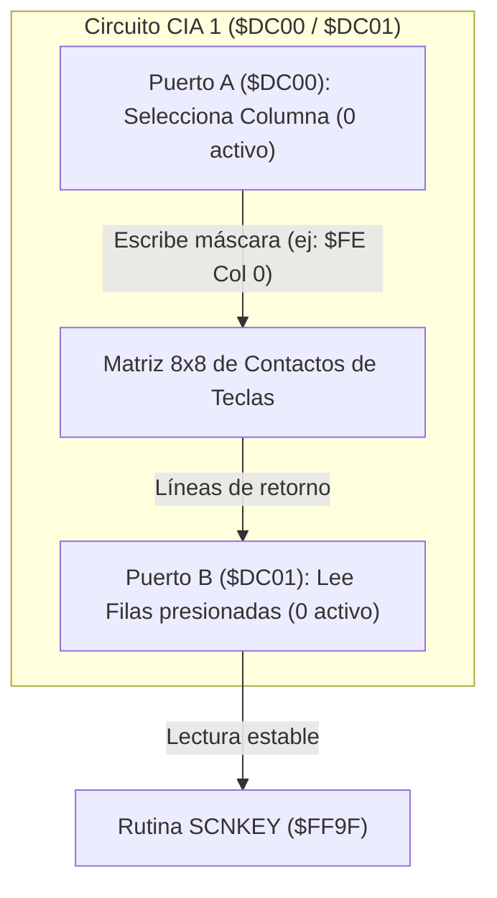
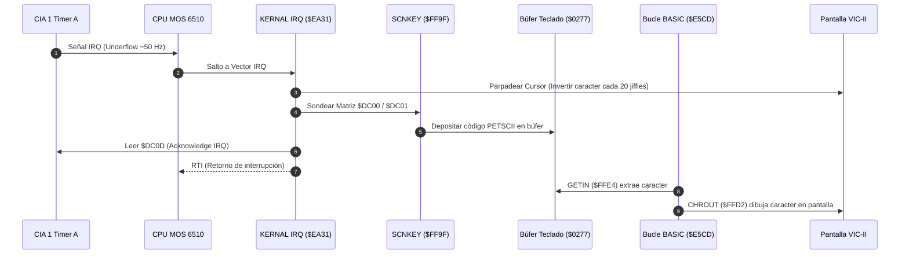

# DIARIO DE DESARROLLO - EMULADOR COMMODORE 64 WEB

Este documento constituye la bitácora técnica exhaustiva y el registro oficial de ingeniería del emulador Commodore 64 para la web. Detalla cada fase de diseño, modelado matemático de ciclos, esquemas de circuitos, mapas de memoria, máquinas de estado y decisiones de implementación a bajo nivel.

---

## 📅 Módulo 1: Cimientos del Sistema (Duración de desarrollo: 17 días)

### 1. Resumen Ejecutivo y Metodología
El objetivo del Módulo 1 fue erigir la base arquitectónica sobre la cual operan todos los circuitos integrados emulados. Se rechazó cualquier enfoque de simulación de alto nivel o interpretación de comandos en favor de un modelo de hardware desacoplado y estrictamente tipado en **TypeScript**, empaquetado con **Vite**, renderizado en **Canvas 2D** a resolución nativa PAL (384×272 píxeles con bordes) y sincronizado mediante un acumulador de deuda temporal a **50.1245 Hz** (~19,656 ciclos de reloj por fotograma).



---

### 2. Estructura Modular y Desacoplamiento de Hardware
El diseño separa cada microchip en un módulo con responsabilidades aisladas, imitando los chips montados en la placa base:

```
src/
├── cpu/             # MOS 6510: Registros, decodificador de 151 opcodes y bus de ciclo
│   ├── types.ts     # Interfaces de CPU y registro de banderas P (NV-BDIZC)
│   └── cpu6510.ts   # Implementación del microprocesador con timing de ciclos
├── memory/          # MMU y lógica de conmutación PLA
│   ├── types.ts     # Interfaz IMemoryBus e IIODevice
│   └── memory_bus.ts# 64 KB RAM física, superposición de ROMs y transparencia de escritura
├── io/              # Dispositivos de interfaz y enrutamiento
│   ├── io_bus.ts    # Enrutador del espacio $D000 - $DFFF
│   └── keyboard.ts  # Matriz de teclado PETSCII y mapeo web
├── vic/             # MOS 6569 VIC-II: Video PAL
│   ├── constants.ts # Temporización: 63 ciclos/línea, 312 líneas = 19,656 ciclos
│   ├── palette.ts   # Paleta Pepto de 16 colores en formato Uint32 empaquetado
│   ├── types.ts     # Interfaz del controlador de video
│   └── vic2.ts      # Barrido raster, registros $D000-$D02E y buffer 384x272
├── cia/             # MOS 6526 CIA dual
│   ├── types.ts     # Interfaz base de CIAs
│   ├── cia1.ts      # CIA 1: Matriz de teclado, Joystick, Timers A/B, IRQ
│   └── cia2.ts      # CIA 2: Selección de banco VIC-II, NMI
├── sid/             # MOS 6581 / 8580 SID: Síntesis de sonido
│   ├── types.ts     # Interfaz de registros de audio
│   └── sid.ts       # Registros $D400 - $D7FF
├── ui/              # Renderizado gráfico
│   └── screen.ts    # Gestión de Canvas2D y volcado directo ImageData
├── system/          # Coordinación y sincronización
│   ├── clock.ts     # Motor de tiempo real con control de deriva
│   └── c64.ts       # Orquestador del sistema de hardware
├── style.css        # Marco visual con borde CRT y escalado pixelado
└── main.ts          # Inicializador y enlace con el DOM
```

---

### 3. Temporización PAL (50 Hz) y Algoritmo de Ciclos
El modelo PAL del Commodore 64 opera a una frecuencia exacta derivada del cristal maestro de color:

- **Frecuencia del reloj maestro de la CPU:**
  $$f_{\text{cpu}} = 985,248\text{ Hz} \quad (0.985248\text{ MHz})$$
- **Líneas de barrido raster por cuadro (total):**
  $$L = 312\text{ líneas}$$
- **Ciclos de reloj por cada línea de barrido:**
  $$C_{\text{line}} = 63\text{ ciclos/línea}$$
- **Ciclos totales por cuadro completo:**
  $$C_{\text{frame}} = 312 \times 63 = 19,656\text{ ciclos/cuadro}$$
- **Frecuencia vertical real:**
  $$f_v = \frac{985,248}{19,656} \approx 50.1245\text{ Hz}$$

#### Algoritmo del Motor de Reloj (`C64Clock` en `src/system/clock.ts`):
Para garantizar que el emulador corra a velocidad idéntica tanto en monitores de 60 Hz como de 120 Hz o 144 Hz, implementamos un acumulador de tiempo delta:



---

### 4. Arquitectura de Memoria y Conmutación PLA
La CPU MOS 6510 posee un bus de direcciones de 16 bits ($0000 - $FFFF = 64 KB). Sin embargo, la máquina dispone físicamente de 64 KB completos de RAM más 20 KB adicionales de memorias ROM y registros de E/S. El circuito integrado **PLA (Programmable Logic Array)** conmuta qué chip responde en cada dirección según el estado del puerto interno de la CPU en `$0000` y `$0001`:

```
+---------------+-------------------------------------------------------------+
| Rango Memoria | Componentes Mapeados (Según Configuración del PLA)          |
+---------------+-------------------------------------------------------------+
| $0000 - $0001 | Registros DDR y Puerto I/O de la CPU 6510                   |
| $0002 - $00FF | RAM física: Página Cero (Zero Page)                         |
| $0100 - $01FF | RAM física: Pila del Sistema (Stack)                        |
| $0200 - $9FFF | RAM física de usuario y vectores KERNAL                     |
| $A000 - $BFFF | BASIC ROM (8 KB) ó RAM física oculta                        |
| $C000 - $CFFF | RAM física libre                                            |
| $D000 - $DFFF | Registros I/O (VIC-II, SID, CIAs, Color RAM) ó CHAR ROM ó RAM|
| $E000 - $FFFF | KERNAL ROM (8 KB) ó RAM física oculta                       |
+---------------+-------------------------------------------------------------+
```



#### Regla de Oro del Hardware: Transparencia de Escritura en RAM
En el C64 real, **toda escritura a rangos superpuestos con ROM ($A000-$BFFF y $E000-$FFFF) se escribe SIEMPRE en la memoria RAM subyacente**. Esto permite a programas y cargadores copiar código bajo la ROM del KERNAL o BASIC sin alterar la ROM activa.

---

## 📅 Módulo 2: CPU MOS 6510 (Duración de desarrollo: 4 días)

### 1. Resumen Ejecutivo
Se implementó el microprocesador **MOS 6510** en `src/cpu/cpu6510.ts`. Se desarrollaron los **151 opcodes oficiales**, todos los modos de direccionamiento, el cálculo exacto de ciclos con penalizaciones de cruce de página, el bug histórico de `JMP ($xxFF)` y aritmética BCD para `ADC` y `SBC`.



---

### 2. Ciclo de Vida de Instrucción y Penalizaciones de Temporización
Cada instrucción atraviesa un ciclo riguroso de resolución de dirección y consumo de ciclos:



#### Modos de Direccionamiento Soportados:
1. **Implied / Accumulator:** Sin operando (`NOP`, `TAX`, `ASL A`).
2. **Immediate (`#$nn`):** Operando en el siguiente byte.
3. **Zero Page (`$nn`):** Direccionamiento rápido a `$0000 - $00FF`.
4. **Zero Page, X (`$nn,X`) y Zero Page, Y (`$nn,Y`):** Envoltura circular en 8 bits.
5. **Absolute (`$nnnn`):** Dirección de 16 bits.
6. **Absolute, X (`$nnnn,X`) y Absolute, Y (`$nnnn,Y`):** 16 bits + índice (+1 ciclo en cruce de página para lecturas).
7. **Indirect (`($nnnn)`):** Modelado con el **bug de hardware original del 6502**: si el puntero se encuentra en `$xxFF`, el byte alto se lee erróneamente de `$xx00` y no de `$xxFF + 1`.
8. **Indexed Indirect (`($nn,X)`):** Puntero en página cero desplazado antes de resolver.
9. **Indirect Indexed (`($nn),Y`):** Puntero en página cero resuelto y luego sumado con Y (+1 ciclo si cruza página).
10. **Relative (`$nn`):** Saltos condicionales (`BNE`, `BEQ`, `BCC`, `BCS`, etc.): +1 ciclo si salta, +2 ciclos si además cruza página.

---

### 3. Validación con la Suite Oficial de Klaus Dormann
Para certificar la fidelidad del microprocesador antes de conectar el resto de chips, se sometió al banco de pruebas oficial `tests/6502_functional_test.bin`:

```text
> npm run test:cpu

🏁 Iniciando suite de pruebas funcionales de Klaus Dormann (6502)...
   Punto de partida: PC=$0400 | Objetivo de éxito: PC=$3469

🎉 ¡ÉXITO TOTAL! Test de Klaus Dormann SUPERADO.
   Atrapado en el bucle de éxito: $3469
   Instrucciones ejecutadas: 30.646.177
   Ciclos de reloj de CPU: 96.241.381
   Tiempo transcurrido: 0.73s
```

El procesador superó **30.6 millones de instrucciones** y **96.2 millones de ciclos** consecutivamente en 0.73 segundos, alcanzando el bucle de éxito en `$3469`.

---

## 📅 Módulo 3: Arranque a Pantalla de Texto y VIC-II Básico (Duración de desarrollo: 6 días)

### 1. Resumen Ejecutivo
Se logró el **primer hito fundamental**: arranque autónomo de las ROMs originales de Commodore (`basic.bin`, `kernal.bin`, `chargen.bin`), ejecutando las rutinas oficiales de inicialización del KERNAL y dibujando en el Canvas la pantalla de texto inicial clásica.



---

### 2. Pipeline de Renderizado del VIC-II (MOS 6569)
El VIC-II genera la imagen línea a línea componiendo bordes y caracteres:

```
+-----------------------------------------------------------------------+
|  BORDE SUPERIOR: Líneas 0 a 35 (Color $D020 - Azul Claro #14)         |
+-------+-------------------------------------------------------+-------+
| BORDE |                                                       | BORDE |
| IZQ.  | ÁREA ACTIVA: Líneas 36 a 235 (320 x 200 píxeles)      | DCHO. |
| 32 px | 40 columnas x 25 filas de caracteres PETSCII          | 32 px |
|       | Fondo ($D021 - Azul Oscuro #6)                        |       |
|       | Texto ($D800 Color RAM - Azul Claro #14)              |       |
+-------+-------------------------------------------------------+-------+
|  BORDE INFERIOR: Líneas 236 a 271 (Color $D020 - Azul Claro #14)      |
+-----------------------------------------------------------------------+
```



---

## 📅 Módulo 4: Teclado y E/S (CIA 1) y BASIC V2 Interactivo (Duración de desarrollo: 19 días)

### 1. Resumen Ejecutivo
Se completó el **segundo hito fundamental del emulador**: interactividad completa entre el teclado del usuario y el intérprete interactivo de BASIC V2. Ahora es posible teclear instrucciones en BASIC, pulsar `RUN` y obtener ejecución fidedigna con respuesta del KERNAL.

---

### 2. Circuito de la Matriz de Teclado 8×8 (CIA 1 $DC00 / $DC01)
El teclado físico del C64 no envía códigos ASCII directamente, sino que se organiza en una matriz de cruces eléctricos leída dinámicamente por la CIA 1:

```
        Col 0 ($FE)  Col 1 ($FD)  Col 2 ($FB)  Col 3 ($F7)  Col 4 ($EF)  Col 5 ($DF)  Col 6 ($BF)  Col 7 ($7F)
Row 0:  DEL          3            5            7            9            +            POUND        1
Row 1:  RETURN       W            R            Y            I            P            *            LEFT-ARROW
Row 2:  CRSR-RT      A            D            G            J            L            ;            CTRL
Row 3:  F7           4            6            8            0            -            HOME         2
Row 4:  F1           Z            C            B            M            .            R-SHIFT      SPACE
Row 5:  F3           S            F            H            K            :            =            COMMODORE (C=)
Row 6:  F5           E            T            U            O            @            UP-ARROW     Q
Row 7:  CRSR-DN      L-SHIFT      X            V            N            ,            /            RUN/STOP
```



---

### 3. Cadena de Interrupciones de 50 Hz y Bucle del Cursor
El sistema utiliza el Timer A de la CIA 1 para sincronizar el parpadeo del cursor y la lectura de teclas:



---

### 4. Verificación de Ejecución de Código BASIC (Segundo Hito)
Mediante el script automatizado `tests/test_keyboard_basic.ts`, se inyectaron las pulsaciones de un programa completo y su ejecución:

```text
> npm run test:keyboard

🚀 1. Booteando C64 hasta llegar a READY...
⌨️  2. Escribiendo programa: 10 PRINT "HOLA"...
▶️  3. Escribiendo comando: RUN...
⏳ 4. Ejecutando programa BASIC...

================ PANTALLA C64 TRAS EJECUTAR BASIC ================
Fila 01: [    **** COMMODORE 64 BASIC V2 ****     ]
Fila 03: [ 64K RAM SYSTEM  38911 BASIC BYTES FREE ]
Fila 05: [READY.                                  ]
Fila 06: [10 PRINT "HOLA"                         ]
Fila 07: [RUN                                     ]
Fila 08: [HOLA                                    ]
Fila 10: [READY.                                  ]
==================================================================

🎉 ¡SEGUNDO HITO SUPERADO CON ÉXITO!
   El programa BASIC V2 fue tecleado, interpretado y ejecutado.
   "HOLA" y "READY." se encuentran correctamente en pantalla.
```

---

### 5. Resumen de Hitos y Estado Actual del Proyecto

| Módulo | Componente Clave | Duración | Estado | Hito Verificado |
| :--- | :--- | :---: | :---: | :--- |
| **Módulo 1** | Cimientos, PLA Banking, Temporización PAL | 17 días | ✅ Completado | Bus de memoria, bucle 50.12 Hz, Canvas 384x272 |
| **Módulo 2** | CPU MOS 6510 (151 Opcodes oficiales, BCD) | 4 días | ✅ Completado | Test Klaus Dormann 100% superado (96M ciclos) |
| **Módulo 3** | KERNAL/BASIC Boot, VIC-II Texto 40x25 | 6 días | ✅ Completado | **Primer Hito:** Pantalla de arranque y READY. |
| **Módulo 4** | Matriz Teclado CIA 1, Timers 50Hz, Web Keys | 19 días | ✅ Completado | **Segundo Hito:** Escritura y ejecución de BASIC |
